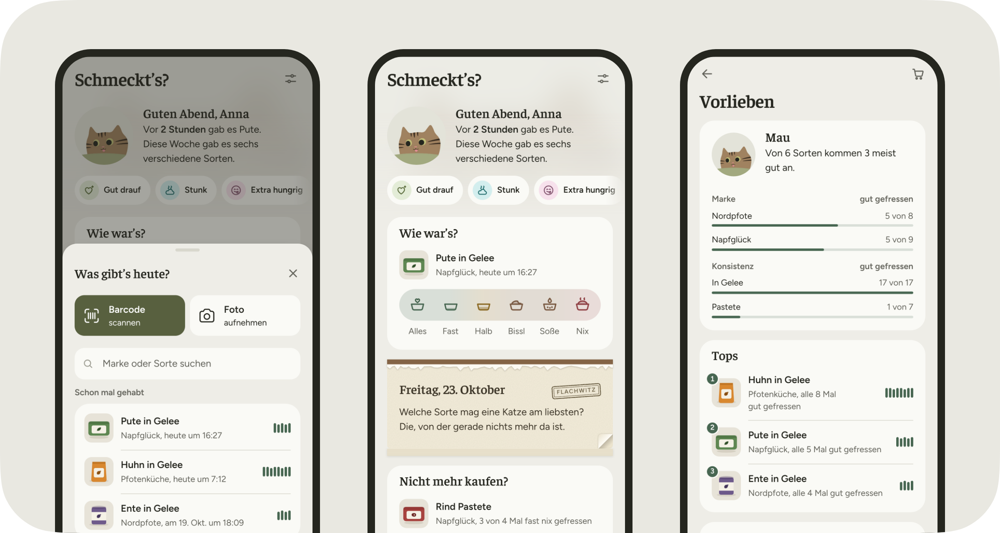

<picture>
  <source media="(prefers-color-scheme: dark)" srcset=".github/readme/hero-dark.svg">
  
</picture>

Mau weiß genau, was ihr schmeckt. Sie sagt es nur nicht. Irgendwas mit Thunfisch kommt zum Beispiel super an, meistens zumindest. Die eine Marke, die so teuer war, fand sie am besten, zumindest gefühlt. Hat sie aktuell einfach wenig Hunger, oder liegt es am Essen? Und beim Einkaufen dann die Frage: Schmeckt ihr das, oder landet das dann wieder im Mülleimer? Lieber immer dasselbe kaufen oder viel Abwechslung? Aus diesen Fragen ist eines Tages in der Küche die Idee für diese App entstanden.

Ein Futtertagebuch für Katzen hält allerdings niemand im Alltag durch, außer es ist wirklich **maximal unkompliziert**. Und auf dem Gedanken baut die ganze App auf, alles muss möglichst schnell und einfach sein und die App macht den Rest und schreibt mit. Beim Füttern fotografiert man die Packung, später wird dann angetippt, wie viel Mau gegessen hat. Nach ein paar Wochen gibt’s dann nützliche Auswertungen der Vorlieben und mehr.

<a href="https://github.com/hazymorning/Schmeckts/releases/latest/download/schmeckts.apk"><picture><source media="(prefers-color-scheme: dark)" srcset=".github/readme/download-dark.svg"></picture></a> 
[So kommt die App aufs Handy](#how-to-install)

- Die Sorte erkennt die App am Barcode, oder sie liest sie direkt vom Foto der Packung ab.
- Bewertet wird mit einem Tipp, von „Alles“ bis „Nix“. Dazwischen gibt es auch „Soße“, für die Tage, an denen nur die Soße geleckt wird.
- Unter „Vorlieben“ sieht man, welche Sorten und Marken gut ankommen und welche eher stehen bleiben. Die Einkaufsliste ergibt sich daraus fast von selbst.
- Frisst Mau ein paar Tage schlechter als sonst, sagt die App Bescheid.
- Ans Füttern und ans Bewerten erinnert sie auf Wunsch auch.
- Mehrere Katzen oder mehrere Leute, die füttern, sind kein Problem.
- Neue Versionen findet die App selbst und installiert sie auf einen Tipp.
- Und jeden Tag gibt es ein Blatt vom Katzenkalender, freitags mit Flachwitz.

Weil Mau bekanntlich sehr auf ihre Privatsphäre achtet, bleibt bei Schmeckt’s? alles auf deinem Handy.

<picture>
  <source media="(prefers-color-scheme: dark)" srcset=".github/readme/screens-dark.png">
  
</picture>

<!-- Der QR-Code springt hierher (…#how-to-install). Nicht löschen. -->

So kommt die App aufs Handy

 

Im Play Store gibt es Schmeckt’s? nicht, nur hier auf GitHub. Deshalb fragt Android beim Installieren ein paar Dinge nach, das ist ganz normal.

<a href="https://github.com/hazymorning/Schmeckts/releases/latest/download/schmeckts.apk"><picture><source media="(prefers-color-scheme: dark)" srcset=".github/readme/download-dark.svg"></picture></a>

1. Diese Seite auf dem Handy öffnen und auf „Download für Android“ tippen. Falls der Browser vor der Datei warnt, trotzdem herunterladen.
2. Die Datei öffnen, sobald sie da ist. Später liegt sie auch als „schmeckts.apk“ in den Downloads.
3. Beim ersten Mal muss man dem Browser erlauben, Apps zu installieren. Dazu auf „Einstellungen“ tippen, „Aus dieser Quelle zulassen“ einschalten und zurückgehen.
4. Auf „Installieren“ tippen. Danach ist Schmeckt’s? bei den anderen Apps zu finden.

Neue Versionen findet die App danach selbst. Beim ersten Update fragt Android noch einmal nach, diesmal, ob Schmeckt’s? Apps installieren darf.

Wenn dabei etwas hakt

 

Play Protect will die App vielleicht erst prüfen, weil sie nicht aus dem Play Store kommt. Das kann man ruhig zulassen.

Lädt man eine neue Version doch mal von Hand, installiert man sie einfach über die alte. Die alte App vorher bitte nicht löschen, sonst sind alle Einträge weg.

Kommt die Meldung „App nicht installiert“, ist meistens noch eine alte Testversion auf dem Handy. Dann in den Einstellungen unter „Backup“ die Einträge sichern, die alte App löschen, die neue installieren und das Backup wieder einlesen.

Auf Handys ohne Google-Dienste funktioniert alles bis auf den Barcode-Scanner, der kommt nämlich von Google.

Ältere Versionen gibt es [hier](https://github.com/hazymorning/Schmeckts/releases).

Wenn mehrere füttern

 

Am besten trägt jeder in den Einstellungen seinen Namen ein, dann steht bei jeder Mahlzeit, wer gefüttert hat. Neue Einträge schickt man sich über „Austausch von Hand“ als Datei, zum Beispiel per WhatsApp. Ein Konto braucht dafür keiner. Unter „Vorlieben“ steht dann übrigens auch, bei wem Mau besser frisst. Das kann zu Diskussionen führen.

Wer sich mit Computern auskennt, kann zu Hause auch einen kleinen [Server](server/) aufstellen, nötig ist das aber nicht. Dann gleichen sich die Handys von selbst ab, und auf Wunsch erkennt eine KI die Sorten auf den Fotos.

Datenschutz

 

Ein großes Thema bei der Entwicklung dieser App ist Datenschutz. Wir sind hier ja in Deutschland, und Deutsche finden Datenschutz einfach super spannend. Zumindest dann, wenn er nicht eingehalten wird. Also, auch wenn die App zugegeben etwas absurd ist, Datenschutz ist wichtig! Deshalb:

Anmelden muss man sich nirgends, und Werbung oder Tracking gibt es auch nicht. Ein paar Ausnahmen, bei denen etwas rausgeht, gibt es trotzdem. Beim Start fragt die App bei GitHub nach, ob es eine neue Version gibt. Dabei geht nur diese Frage raus, keine Einträge. Abschalten lässt sich das in den Einstellungen unter „Updates“. Der Barcode-Scanner kommt von Google und schickt laut Google allgemeine Daten mit, zum Beispiel welches Handy man hat. Bilder sind nicht dabei.

Alles andere passiert nur, wenn man es selbst einschaltet. Die „Sortensuche im Internet“ schaut unbekannte Barcodes in zwei freien Datenbanken nach und schickt dabei nur die Nummer. Mit „Fotos mit eigener KI erkennen“ gehen die Packungsfotos direkt an Anthropic, OpenAI oder Google, je nachdem, von wem der eigene Schlüssel ist. Und steht zu Hause ein Server, schickt der die Fotos an Anthropic, damit dort eine KI die Sorte erkennt. Das lässt sich in den Einstellungen unter „Fotos über den Server erkennen“ abschalten.

Fragen und Probleme

 

Fragen und Ideen sind im [Forum](https://github.com/hazymorning/Schmeckts/discussions) gut aufgehoben. Wenn etwas nicht richtig funktioniert, bitte [hier](https://github.com/hazymorning/Schmeckts/issues/new/choose) melden. Das Formular fragt nach der App-Version, die steht ganz unten in den Einstellungen.

<!-- Wenn das Repo öffentlich ist, können diese Badges oben mit rein. Sie aktualisieren sich von selbst:
  
  
-->
