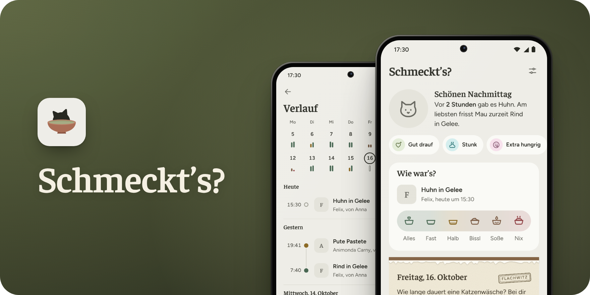
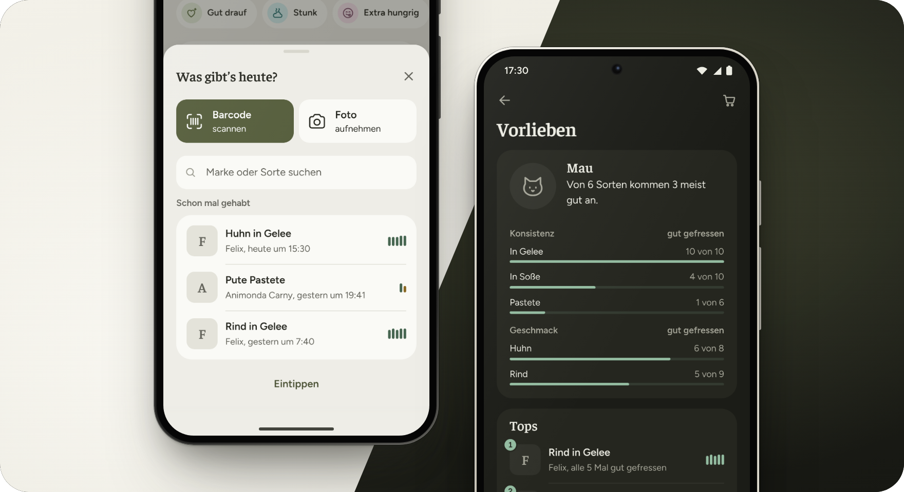

Katzen sind wählerisch: Was letzte Woche noch ratzeputz aufgefressen wurde, bleibt heute stehen. Welche Sorte wann wie ankam, weiß nach einem Monat niemand mehr. Mitschreiben würde helfen, aber das hält im Alltag kaum jemand lange durch.

Schmeckt’s? ist deshalb so gebaut, dass es nebenbei geht. Pro Mahlzeit sind es zwei, drei Tipper, den Rest rechnet die App selbst aus. Mit der Zeit zeigt sie dir, welche Sorten deiner Katze wirklich schmecken.

<a href="#installieren"><picture><source media="(prefers-color-scheme: dark)" srcset="https://github.com/user-attachments/assets/1798bb44-ce7c-4fe1-aa79-b14bd7346e2e"></picture></a>

## So geht’s

1. Beim Füttern den Barcode scannen oder die Packung fotografieren. Bekannte Sorten sind damit schon eingetragen, neue liest die App vom Foto ab.
2. Später mit einem Tipp sagen, wie viel gefressen wurde, von „Alles“ bis „Nix“. Auf Wunsch geht das direkt in der Benachrichtigung.
3. Nach ein paar Wochen unter „Vorlieben“ nachsehen, was ankommt und was du dir beim nächsten Einkauf sparen kannst.

<b>Was die App sonst noch kann</b>

 

- Oben auf der Startseite steht in einem Satz, wann es zuletzt was gab und wie es ankam.
- Hältst du das App-Symbol gedrückt, bist du mit einem Tipp beim Scanner oder bei der Kamera.
- Die App merkt, ob deine Katze Gelee lieber mag als Soße, welche Marken ankommen und ob Snacks den Appetit verderben.
- Frisst deine Katze ein paar Tage schlechter als sonst, sagt dir die App Bescheid.
- Eine Einkaufsliste mit allem, was sich nachzukaufen lohnt, zum Weiterschicken an den, der gerade einkaufen geht.
- Beobachtungen wie „Gut drauf“, „Stunk“ oder „Erbrochen“ notierst du mit einem Tipp. Häufen sie sich nach einer Sorte, fällt das der App auf.
- Auf Wunsch erinnert sie dich ans Füttern, wenn zur üblichen Zeit noch nichts eingetragen ist.
- Jeden Tag ein Blatt vom Katzenkalender, mit Wissen, Kuriosem und freitags einem Flachwitz.
- Mehrere Katzen, helles und dunkles Design, Backup fürs neue Handy.

<b>Wenn mehrere Leute füttern</b>

 

Trag in den Einstellungen deinen Namen ein, dann steht bei jeder Mahlzeit, wer gefüttert hat. Neue Einträge schickst du über „Austausch von Hand“ als Datei ans andere Handy, etwa per Messenger, ganz ohne Konto. Schmeckt es bei jemandem deutlich besser, steht das unter „Vorlieben“.

Wer mag, stellt einen kleinen [Server](server/) ins Heimnetz. Der gleicht die Handys dann von selbst ab und erkennt Sorten am Foto. Nötig ist er nicht.

<!-- Der QR-Code springt hierher (…#how-to-install). Nicht löschen. -->

## Installieren

Du lädst die App hier herunter, ein Android-Handy ab Version 7 reicht.

1. Öffne diese Seite auf dem Handy, tippe auf den Button und behalte die Datei, falls der Browser nachfragt.
2. Tippe auf „Öffnen“ oder such `schmeckts.apk` in deinen Downloads.
3. Beim ersten Mal fragt Android, ob der Browser Apps installieren darf: „Einstellungen“, „Aus dieser Quelle zulassen“, zurück.
4. „Installieren“, „Öffnen“, füttern.

<b>Wenn’s hakt</b>

 

„Play Protect“ will die App prüfen, weil sie nicht aus dem Play Store kommt. Zulassen, fertig.

Updates installierst du einfach über die alte Version drüber. Wer vorher deinstalliert, fängt von vorne an.

Kommt „App nicht installiert“, ist meist noch eine alte Testversion drauf. Dann ein Backup machen, die alte App löschen, die neue installieren und das Backup zurückholen.

Ohne Google-Dienste läuft alles außer dem Barcode-Scanner, der kommt von Google.

Ältere Versionen findest du unter [Releases](https://github.com/hazymorning/Schmeckts/releases).

## Datenschutz

Weil Katzen bekanntlich großen Wert auf ihre Privatsphäre legen, bleibt bei Schmeckt’s? alles auf deinem Handy. Es gibt kein Konto, keine Cloud, keine Werbung und kein Tracking.

<b>Wann doch etwas das Handy verlässt</b>

 

Der Barcode-Scanner kommt von Google und schickt laut Google Gerätedaten wie das Handymodell mit, aber keine Bilder. Die Sortensuche im Internet ist anfangs aus. Schaltest du sie ein, fragt sie bei unbekannten Barcodes zwei freie Datenbanken, und zwar nur mit der Nummer. Hast du einen eigenen KI-Schlüssel hinterlegt, gehen Packungsfotos direkt an dessen Anbieter. Ein Server im Heimnetz schickt sie zur Erkennung an Anthropic, solange das eingeschaltet ist.

## Fragen und Fehler

Fragen und Ideen gern in die [Diskussionen](https://github.com/hazymorning/Schmeckts/discussions), Fehler bitte [hier melden](https://github.com/hazymorning/Schmeckts/issues/new/choose), am besten mit Handymodell, Android- und App-Version.

<!-- Wenn das Repo öffentlich ist, können diese Badges oben mit rein. Sie aktualisieren sich von selbst:
  
  
-->
