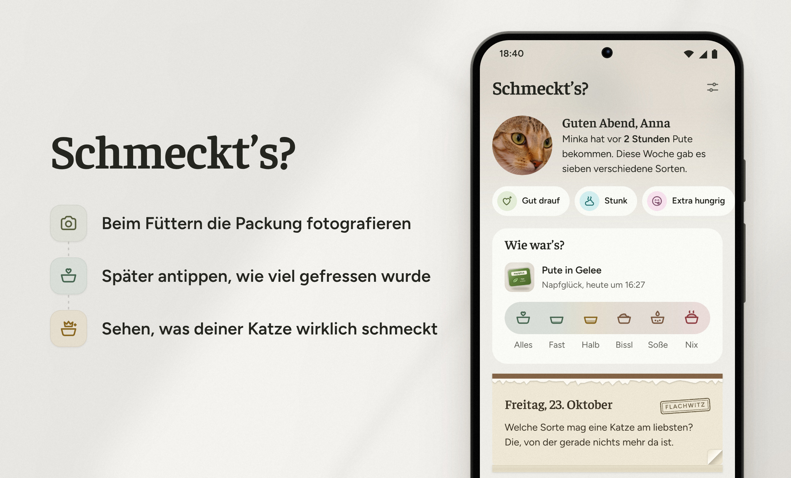
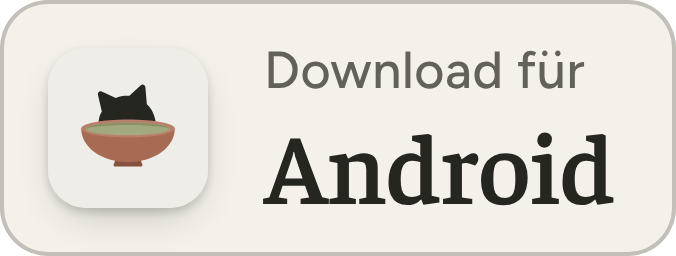
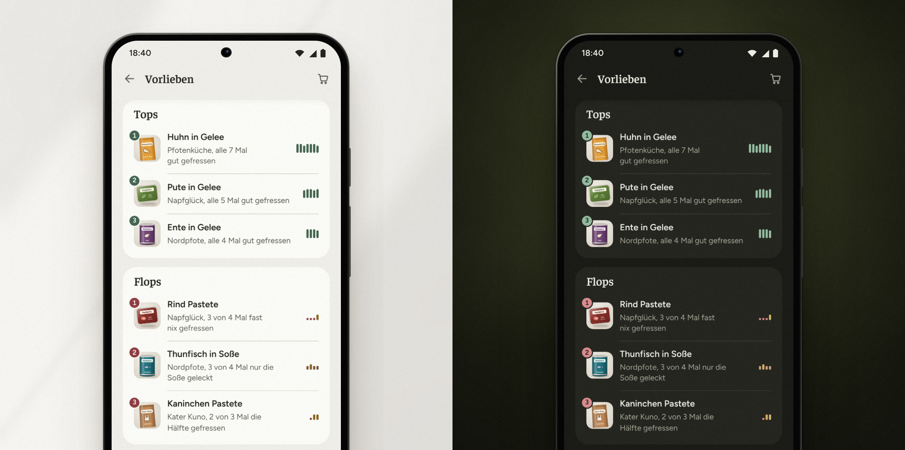

<picture>
  <source media="(prefers-color-scheme: dark)" srcset=".github/readme/header-dark.jpg">
  
</picture>

Schmeckt’s? ist ein Futtertagebuch für Katzen. Du trägst ein, welche Sorte deine Katze bekommt und wie viel sie davon frisst. Mit der Zeit siehst du dann, welche Sorten ihr schmecken und welche du beim Einkaufen im Regal lassen kannst.

So ein Tagebuch hält man im Alltag aber nur durch, wenn es kaum Arbeit macht. Deshalb dreht sich bei Schmeckt’s? alles darum, dass du möglichst wenig tun musst. Beim Füttern tippst du meistens nur zwei- bis viermal.

<a href="https://github.com/hazymorning/Schmeckts/releases/latest/download/schmeckts.apk"><picture><source media="(prefers-color-scheme: dark)" srcset=".github/readme/download-dark.png"></picture></a> 
[So kommt die App aufs Handy](#installieren)

## So geht’s

1. Beim Füttern scannst du den Barcode oder fotografierst die Packung. Wenn die App die Sorte erkennt, bist du damit schon fertig. Bei einer neuen Sorte schlägt sie dir den Namen von der Packung vor, und wenn er stimmt, tippst du auf „Passt so“.
2. Später tippst du an, wie viel deine Katze gefressen hat, von „Alles“ bis „Nix“. Wenn du dich daran erinnern lässt, geht das auch direkt in der Benachrichtigung.
3. Nach ein paar Wochen siehst du unter „Vorlieben“, welche Sorten gut ankommen und welche deine Katze lieber stehen lässt.

<b>Was die App sonst so kann</b>

 

- Beim Füttern stehen die Sorten, die es zuletzt gab, unter „Schon mal gehabt“. Da tippst du einfach die richtige an. Wenn du lange auf das App-Symbol drückst, kannst du auch gleich scannen oder ein Foto machen.
- Wenn zur üblichen Zeit noch nichts eingetragen ist, kann dich die App ans Füttern erinnern.
- Unter „Vorlieben“ siehst du mit der Zeit auch, welche Marke am besten ankommt und ob deine Katze lieber Gelee oder Pastete mag.
- Auf der Startseite steht ein Hinweis, wenn deine Katze ein paar Tage lang schlechter frisst als sonst.
- Du kannst auch festhalten, ob deine Katze gut drauf ist oder sich übergeben hat. Die App sagt dir, wenn so etwas nach einer bestimmten Sorte öfter vorkommt.
- Unter „Einkaufen“ steht, was du nachkaufen kannst und was lieber nicht mehr. Du kannst die Liste auch jemandem schicken, der gerade im Laden ist.
- Jeden Tag kannst du auf der Startseite ein Blatt vom Katzenkalender abreißen. Freitags steht ein Flachwitz drauf.
- Es geht auch mit mehreren Katzen. Beim Handywechsel machst du ein Backup und liest es auf dem neuen Handy wieder ein.

<b>Wenn ihr euch das Füttern teilt</b>

 

Am besten trägt jeder von euch in den Einstellungen seinen Namen ein. Dann ist bei jeder Mahlzeit klar, wer gefüttert hat. Über „Austausch von Hand“ schickt ihr euch neue Einträge als Datei, zum Beispiel per WhatsApp. Ein Konto braucht ihr dafür nicht. Unter „Vorlieben“ steht sogar, wenn eure Katze bei einem von euch besser frisst.

Wenn sich jemand bei euch mit Computern auskennt, könnt ihr zu Hause auch einen kleinen [Server](server/) einrichten. Dann landen neue Einträge von selbst auf allen Handys, und wenn ihr wollt, erkennt eine KI die Sorten auf euren Fotos. Die App kommt aber auch ganz ohne Server aus.

<!-- Der QR-Code springt hierher (…#how-to-install). Nicht löschen. -->

## Installieren

Die App gibt es nicht im Play Store, aber du kannst sie hier herunterladen. Dein Handy braucht mindestens Android 7.

<a href="https://github.com/hazymorning/Schmeckts/releases/latest/download/schmeckts.apk"><picture><source media="(prefers-color-scheme: dark)" srcset=".github/readme/download-dark.png"></picture></a>

1. Öffne diese Seite auf deinem Handy und tippe auf „Download für Android“. Falls der Browser vor der Datei warnt, lade sie trotzdem herunter.
2. Sobald die Datei heruntergeladen ist, öffne sie. Du findest sie auch später noch als „schmeckts.apk“ in deinen Downloads.
3. Beim ersten Mal musst du deinem Browser erlauben, Apps zu installieren. Tippe dazu auf „Einstellungen“, schalte „Aus dieser Quelle zulassen“ ein und geh zurück.
4. Tippe auf „Installieren“. Danach findest du Schmeckt’s? bei deinen anderen Apps.

<b>Wenn etwas nicht klappt</b>

 

Play Protect möchte die App vielleicht erst prüfen, weil sie nicht aus dem Play Store kommt. Das kannst du ruhig zulassen.

Für ein Update installierst du die neue Version einfach über die alte. Lösch die alte App vorher nicht, sonst sind alle Einträge weg.

Hinter der Meldung „App nicht installiert“ steckt meistens eine alte Testversion, die noch auf dem Handy ist. Sichere dann in den Einstellungen unter „Backup“ deine Einträge und lösch die alte App. Danach installierst du die neue und liest das Backup wieder ein.

Auf Handys ohne Google-Dienste geht nur der Barcode-Scanner nicht, weil er von Google kommt.

Ältere Versionen findest du [hier](https://github.com/hazymorning/Schmeckts/releases).

## Datenschutz

Weil Katzen bekanntlich sehr auf ihre Privatsphäre achten, bleibt bei Schmeckt’s? alles auf deinem Handy. Du musst dich nirgends anmelden, und Werbung oder Tracking gibt es auch nicht.

<b>Es gibt ein paar Ausnahmen</b>

 

Der Barcode-Scanner kommt von Google. Laut Google schickt er allgemeine Daten mit, zum Beispiel welches Handy du hast. Bilder sind nicht dabei.

Alles andere ist freiwillig. Wenn du die „Sortensuche im Internet“ einschaltest, schaut die App unbekannte Barcodes in zwei freien Datenbanken nach und schickt dabei nur die Nummer.

Wenn du „Fotos mit eigener KI erkennen“ nutzt, gehen die Packungsfotos direkt an Anthropic, OpenAI oder Google, je nachdem, von wem dein Schlüssel ist. Falls du zu Hause einen Server hast, schickt er die Fotos an Anthropic, und dort erkennt eine KI die Sorte. Das kannst du in den Einstellungen bei „Fotos über den Server erkennen“ abschalten.

## Fragen und Probleme

Fragen und Ideen sind im [Forum](https://github.com/hazymorning/Schmeckts/discussions) gut aufgehoben. Wenn etwas nicht richtig funktioniert, melde es bitte [hier](https://github.com/hazymorning/Schmeckts/issues/new/choose). Das Formular fragt dabei nach der App-Version, die ganz unten in den Einstellungen steht. Für beides brauchst du ein kostenloses Konto bei GitHub.

<!-- Wenn das Repo öffentlich ist, können diese Badges oben mit rein. Sie aktualisieren sich von selbst:
  
  
-->
